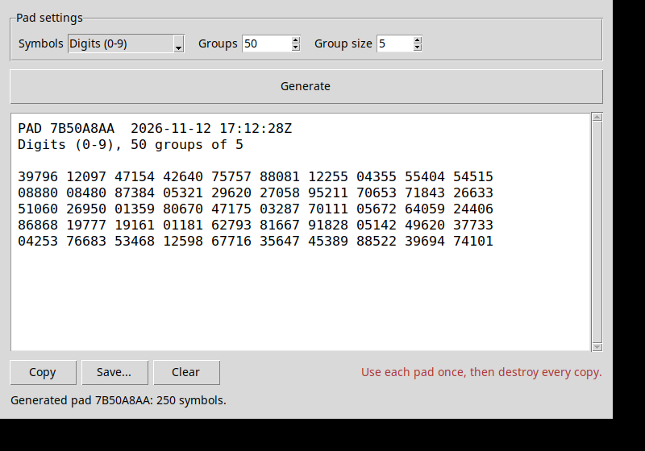
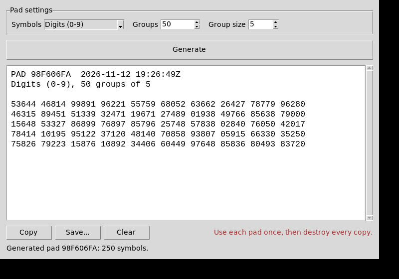

# One-Time Pad Generator

The One-Time Pad Generator is a desktop application that produces One-Time Pad (OTP) key material on Windows, macOS, and Linux, including the Raspberry Pi. The user starts the application, selects **Generate**, and the window fills with random numbers laid out in five-digit groups, the format pads have used on paper for the better part of a century. This document covers where the randomness comes from, how to operate the application, and how to run or build it on each platform; it is not intended to teach OTP cryptography beyond the rules an operator has to follow.



## Source of Randomness

Every symbol is drawn through Python's `secrets` module, which reads the operating system's Cryptographically Secure Pseudorandom Number Generator (CSPRNG): `getrandom()` on Linux, `BCryptGenRandom` on Windows, and the kernel CSPRNG on macOS. The application never seeds or manages a generator of its own. `secrets.choice` selects each symbol with rejection sampling, which means every digit or letter is equally likely and the pad carries no modulo bias; the test suite backs this up with a chi-square check on 100,000 generated digits.

A CSPRNG is not a hardware entropy source, and a purist would point out that a textbook OTP calls for true randomness; however, for practical use the operating system generator is assessed to be the strongest source available to a portable application, and it is the same source the operating system relies on for its own encryption keys.

## Operating the Application

| Control | Function |
|---|---|
| Symbols | Digits (0-9), Letters (A-Z), or Hex (0-9, A-F) |
| Groups | Number of groups to generate, 1 to 1000 (default 50) |
| Group size | Symbols per group, 1 to 20 (default 5) |
| Generate | Creates a new pad; `Enter` does the same |
| Copy | Places the pad on the clipboard |
| Save... | Writes the pad to a text file; `Ctrl+S` does the same |
| Clear | Removes the pad from the window |

Each pad carries a random eight-character Pad ID and a Coordinated Universal Time (UTC) timestamp in its header, so the two parties holding copies can confirm they are working from the same sheet before anything is encrypted.

## Running It

### Prebuilt Downloads

The [Releases](https://github.com/dw-solution/one-time-pad/releases) page carries a standalone build for each platform. None of them require Python.

| File | Platform | First launch |
|---|---|---|
| `OneTimePad-windows.exe` | Windows 10 or 11 | SmartScreen warns because the build is unsigned; choose **More info**, then **Run anyway** |
| `OneTimePad-macos.zip` | macOS on Apple Silicon | Unzip to `OneTimePad.app`, then right-click and choose **Open** |
| `OneTimePad-linux` | 64-bit Intel and AMD Linux | `chmod +x OneTimePad-linux` |
| `OneTimePad-linux-arm64` | 64-bit ARM Linux, including a Raspberry Pi 3, 4, 5, or Zero 2 W on 64-bit Raspberry Pi OS Bookworm or newer | `chmod +x OneTimePad-linux-arm64` |

Both Linux builds are made on Ubuntu 22.04 and need glibc 2.35 or newer. A 32-bit Raspberry Pi OS, or any release older than Bookworm, cannot run them, and neither can an Intel Mac run the macOS build; run from source on any of those instead.

### From Source

Running from source needs Python 3.7 or newer with Tkinter and nothing else; there are no third-party dependencies. The python.org installers for Windows and macOS include Tkinter. On Ubuntu or Debian, install it with `sudo apt install python3-tk`. Raspberry Pi OS with the desktop already has it.

```
git clone https://github.com/dw-solution/one-time-pad.git
cd one-time-pad
python3 onetimepad.py
```

### On a Raspberry Pi

Running from source is the method that works on every Pi, whatever the model or operating system release. The screenshot below was taken from a Raspberry Pi 4 Model B on 32-bit Raspbian 10 (Buster) with Python 3.7.3, where the full test suite also passed. That Pi runs headless, so the window was drawn on a workstation over Secure Shell (SSH) with X11 forwarding:

```
ssh -X pi@<pi-address>
cd one-time-pad
python3 onetimepad.py
```

X11 forwarding needs `X11Forwarding yes` in the Pi's `/etc/ssh/sshd_config` and the `xauth` package installed; both are present on a stock Raspberry Pi OS image. A Pi with a monitor attached simply runs `python3 onetimepad.py` from its own desktop.



### Tests

```
python3 -m unittest discover -s tests -v
```

## Building the Binaries

```
pip install pyinstaller
pyinstaller --onefile --windowed --name OneTimePad onetimepad.py
```

The build lands in `dist/`. PyInstaller only builds for the platform it runs on, so a Windows binary has to be built on Windows, and so on. The GitHub Actions workflow in `.github/workflows/build.yml` handles this across all four targets on every push, and attaches the binaries to a release whenever a `v*` tag is pushed.

## Layout

```
onetimepad.py      entry point and PyInstaller target
otp/pad.py         pad generation and formatting
otp/gui.py         Tkinter interface
tests/test_pad.py  unit tests
docs/              screenshots
```

## Operational Rules

An OTP is unbreakable only when the key is random, at least as long as the message, kept secret, and never reused. The application supplies the randomness and lets the operator size the pad to the message; secrecy and single use are the operator's job. Use each pad once, then destroy every copy, including saved files and anything left on the clipboard, because reusing a pad gives an adversary two messages encrypted under the same key and defeats the scheme entirely.
